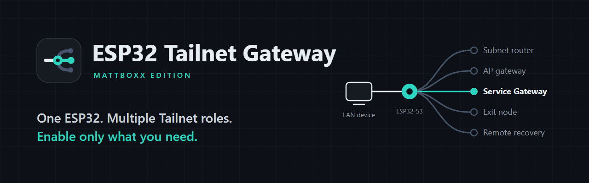
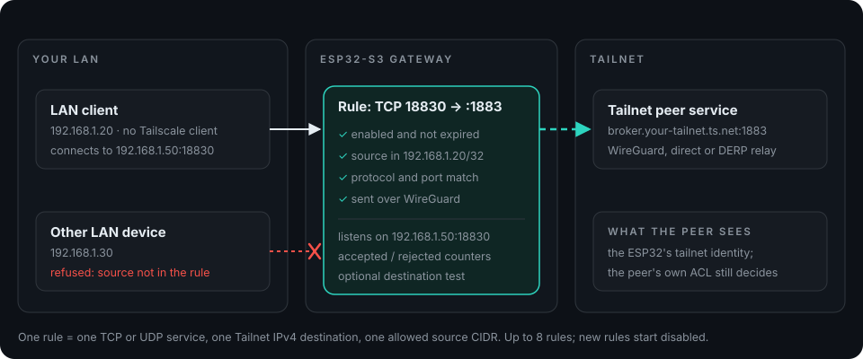
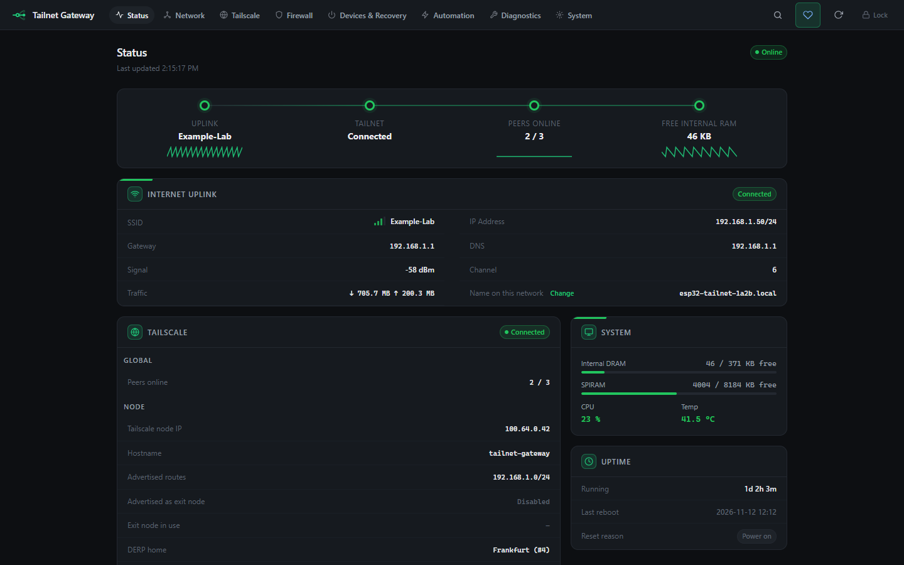
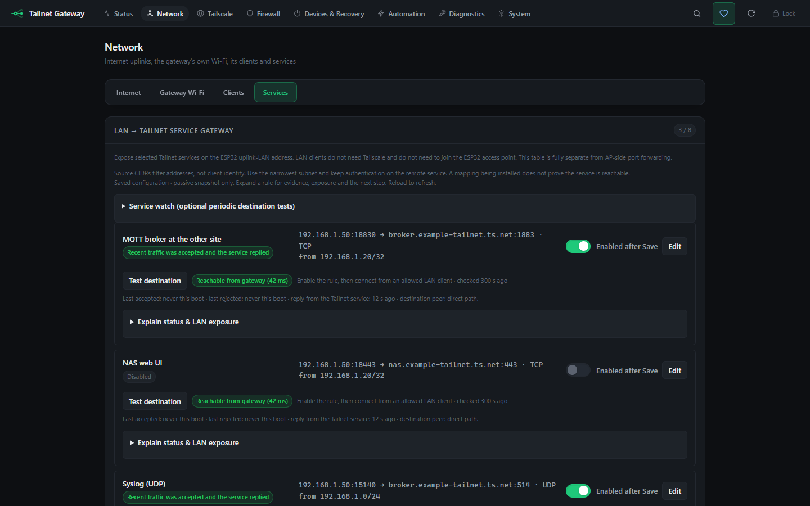
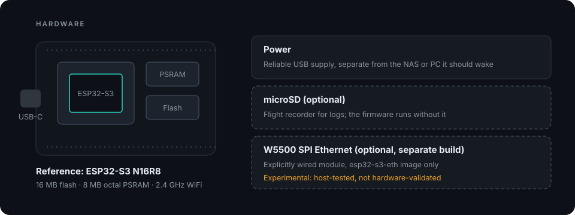

# ESP32 Tailnet Gateway — Mattboxx Edition

**Mattboxx Edition · One ESP32. Multiple Tailnet roles. Enable only what you need.**

All-in-one ESP32-S3 Tailscale/Headscale gateway with selective LAN-to-Tailnet
access, subnet routing, remote recovery and optional automation.

**ESP32-S3 N8R8 / N16R8 · 8 MB octal PSRAM**

[Install in your browser](https://mattboxx.github.io/esp32-tailnet-gateway/install-firmware/) ·
[Download firmware](../../releases/latest) ·
[Setup guide](docs/GETTING-STARTED.md) ·
[Website](https://mattboxx.github.io/esp32-tailnet-gateway/)

## What you can do

| Use case | What the ESP32 does |
| --- | --- |
| **Connect devices that cannot run Tailscale** | Forward one TCP or UDP service from the local LAN to a Tailnet peer. Restrict the source by IP/CIDR. |
| **Reach a remote LAN** | Advertise approved subnets to Tailnet clients. Configure the gateway's own Wi-Fi for IoT devices. |
| **Wake and check a NAS or PC** | Send Wake-on-LAN and verify reachability from Telegram or ntfy, even without Tailscale. [Setup and command reference](https://mattboxx.github.io/esp32-tailnet-gateway/remote-recovery/#commands). |
| **Monitor and automate** | Track events and resource trends locally. Optionally use MQTT and Home Assistant, ntfy, Telegram, email or SNMP. |

## Quick start

1. **Check your board.** Use an ESP32-S3 N8R8 or N16R8 with 8 MB octal PSRAM. See [supported hardware](#8-supported-hardware).
2. **Install.** Open the [Web Installer](https://mattboxx.github.io/esp32-tailnet-gateway/install-firmware/) in desktop Chrome or Edge with a USB data cable. You can also use [Easy Install or the advanced downloads](#7-download-firmware).
3. **Set up.** Join the board's `ESP32-Tailnet-Setup-XXXX` Wi-Fi, pair using the BOOT button or USB setup code, and test your uplink. Open the address shown at the end of the wizard.
4. **Join your Tailnet.** Connect to Tailscale or Headscale, then enable the role you need.

[First-boot walkthrough](docs/GETTING-STARTED.md) · [Update an existing gateway](https://mattboxx.github.io/esp32-tailnet-gateway/updating/)

## LAN → Tailnet Service Gateway

For example, a home automation controller at a second site can send MQTT
messages to a broker on your Tailnet. The controller connects to the ESP32's
LAN address. The ESP32 forwards the connection to the broker using one rule
that specifies the destination, protocol, port and allowed source.

[Configure your first service rule](docs/SERVICE-GATEWAY.md) ·
[MQTT between two homes](https://mattboxx.github.io/esp32-tailnet-gateway/mqtt-across-networks/)

## Web interface

Screenshots show the embedded Firmware 3.0.19 interface with fictional
configuration, peers and measurements. Open an image for the full view.

| Status | Service Gateway |
| --- | --- |
|  |  |

[Browse the gallery](https://mattboxx.github.io/esp32-tailnet-gateway/screenshots/) for mobile, first boot, recovery, alerts, firewall and diagnostics.

## What's new in Firmware 3.0.19

- **OTA recovery** keeps a new image pending during startup and reserves the
  restart task before accepting a manual upload.
- **Scheduled Recovery checks** skip disabled devices and distinguish local
  probe errors from a failed target check.
- **ntfy** queues and retries operational results, preserving pending results
  when unrelated preferences are saved.
- **Networking** improves Wi-Fi queue handling under load and avoids redundant
  mDNS probing when the uplink address is unchanged.

[Install Firmware 3.0.19](https://mattboxx.github.io/esp32-tailnet-gateway/install-firmware/)
· [Full changelog](CHANGELOG.md)

## Downloads

| Method | Use it for |
| --- | --- |
| [Web Installer](https://mattboxx.github.io/esp32-tailnet-gateway/install-firmware/) | First install from desktop Chrome or Edge over USB |
| [Easy Install](https://mattboxx.github.io/esp32-tailnet-gateway/easy-install/) | Guided USB setup on Windows, macOS or Linux |
| [GitHub Releases](../../releases/latest) | OTA image, factory image, checksums, provenance and license notices |

To update an existing gateway, use **System → Firmware**. Factory installs
can erase settings. See [the update and rollback guide](https://mattboxx.github.io/esp32-tailnet-gateway/updating/)
and verify release files against `SHA256SUMS.txt`.
For the historical 3.0.2 notice bundles, see [their separate checksums](licenses/releases/v3.0.2/LICENSE-SHA256SUMS.txt).

## Supported hardware

Firmware 3.x runs on **ESP32-S3 with 8 MB octal PSRAM and at least 8 MB of
quad flash**:

| Supported | Not supported |
|---|---|
| **N16R8** — e.g. ESP32-S3-DevKitC-1 N16R8, WROOM-1/1U-N16R8 (**tested**) | 4 MB flash (N4…) |
| **N8R8** — e.g. ESP32-S3-DevKitC-1 N8R8, WROOM-1/1U-N8R8, Freenove N8R8, Seeed XIAO ESP32S3 (same layout, not yet tested on 3.x) | R2 or no PSRAM, octal-flash modules (WROOM-2, N16R16V, N32R8V), other ESP32 chips |

Details and community reports: [Hardware](docs/HARDWARE.md).

## Documentation

| Area | Start here |
| --- | --- |
| Setup, hardware and configuration | [Getting started](docs/GETTING-STARTED.md) · [Hardware](docs/HARDWARE.md) · [Configuration](docs/CONFIGURATION.md) |
| Networking | [Service Gateway](docs/SERVICE-GATEWAY.md) · [Network modes](https://mattboxx.github.io/esp32-tailnet-gateway/network-modes/) · [Dynamic DNS](docs/DDNS.md) |
| Recovery and automation | [NAS recovery](docs/NAS-RECOVERY.md) · [Smart Recovery](docs/SMART-RECOVERY.md) · [Automation](https://mattboxx.github.io/esp32-tailnet-gateway/automation/) |
| Operations | [Security policy](SECURITY.md) · [Diagnostics](https://mattboxx.github.io/esp32-tailnet-gateway/diagnostics/) · [Release history](CHANGELOG.md) |
| Development | [Documentation index](docs/README.md) · [Testing](docs/TESTING.md) · [Wiki](https://github.com/Mattboxx/esp32-tailnet-gateway/wiki) |

## Security

- PBKDF2-HMAC-SHA256 password verifier with a one-time login challenge,
  device-wide login budget, `SameSite=Strict` session cookie.
- State-changing requests are screened against cross-origin and cross-site
  use; untrusted `Host` names are refused when no password is set (DNS
  rebinding).
- First boot is restricted to the setup AP, requires physical pairing and
  seals setup requests with X25519/AES-256-GCM. It does not authenticate the
  downloaded page against an active nearby impersonator; use a trusted setup site.
- Tailnet authorization is checked on original packets before NAT, fails
  closed on malformed or revoked policy and is not a claim of full
  official-client policy parity.
- A Service Gateway source filter is **not** client identity: prefer `/32`.
- The local Web UI is HTTP; administer it from a trusted LAN/AP or over the
  tailnet. The portable image does not enable Secure Boot or flash encryption.

Report vulnerabilities privately: see [SECURITY.md](SECURITY.md).

## Limits

- **Estimated peak Tailnet transfer speed:** roughly **8 Mbit/s (1 MB/s)**
  over a direct Wi-Fi tunnel in favorable conditions. A W5500 Ethernet
  uplink may improve that by removing Wi-Fi airtime contention. The
  firmware's sustained Ethernet ceiling remains unmeasured. Relay paths
  and concurrent traffic can reduce throughput.
- **Service Gateway scope:** IPv4 TCP/UDP, up to 8 rules, one Tailnet IPv4
  destination per rule; a port forwarder, not transparent routing. UDP cannot
  be verified without an application reply.
- **Exit node:** IPv4 only; IPv6 fails closed. A selected exit node fails
  closed when unreachable.
- **Not supported:** tailnet lock; Headscale with self-signed certificates.
- **Experimental hardware:** W5500 requires compatible hardware and pin settings.
  This embedded community client does not promise full official-client policy parity.
  See [release availability](docs/PRESENTATION-STATUS.md).

## Contributing

Bug reports, hardware reports and guide improvements are welcome. Read
[CONTRIBUTING.md](CONTRIBUTING.md) and the [code of conduct](CODE_OF_CONDUCT.md);
use the issue templates. Follow the checks in [Testing](docs/TESTING.md) for
the published source.

Support the Mattboxx edition on GitHub Sponsors or Ko-fi — entirely optional.
The firmware and all features remain free:

## Credits and licences

GPL-3.0-only ([LICENSE](LICENSE)) with an additional permission for ESP-IDF and
Espressif's binary libraries and terms on attribution and on the Mattboxx name
([LICENSE-EXCEPTION.md](LICENSE-EXCEPTION.md)), for all Mattboxx code from
8 November 2026 and every release from 3.0.12. Releases up to 3.0.11 were
published under MIT and copies of them keep those terms. The original firmware's MIT notice is kept in
[licenses/upstream](licenses/upstream/esp32-tailscale-subnet-router-MIT.txt). Built on:

- **[Csontikka/esp32-tailscale-subnet-router](https://github.com/Csontikka/esp32-tailscale-subnet-router)** —
  the original firmware this edition builds on. Support the upstream author via
  [GitHub Sponsors](https://github.com/sponsors/Csontikka) or
  [Buy Me a Coffee](https://buymeacoffee.com/csontikka).
- **[Mattboxx/microlink](https://github.com/Mattboxx/microlink)** — the pinned
  networking dependency, derived through [Csontikka's fork](https://github.com/Csontikka/microlink)
  from **Cameron Malone's [original MicroLink](https://github.com/CamM2325/microlink)**.
  The current fork uses GPL-3.0-only with an ESP-IDF linking permission and
  preserves the original MIT and third-party notices. Previously published
  firmware retains the terms of the MicroLink revision it shipped.
- **[wireguard_lwip](https://github.com/smartalock/wireguard-lwip)** — Daniel Hope's
  userspace WireGuard for lwIP (BSD-3-Clause), with separately licensed crypto notices.
- **[ESP-IDF](https://github.com/espressif/esp-idf)** — Espressif SDK (primarily
  Apache-2.0; bundled libraries retain their own licenses).

Full attribution: [NOTICE.md](NOTICE.md). Brand assets: [assets/brand](assets/brand/BRAND.md).
Bundled third-party components and the separately distributed esptool
flashing program retain their respective licences.
ESP32 Tailnet Gateway is independent community firmware. It is not affiliated
with Tailscale Inc., the Headscale project or Espressif.
Tailscale, Headscale, WireGuard and ESP32 are trademarks of their respective
owners. Legacy README: [1.13 documentation](https://github.com/Mattboxx/esp32-tailnet-gateway/blob/v0.1.38-Mattboxx-1.13/README.md).
