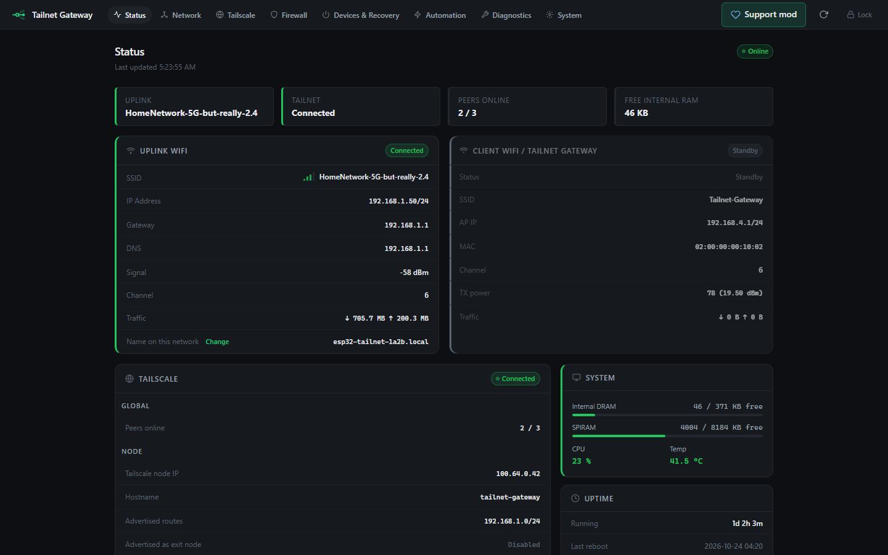
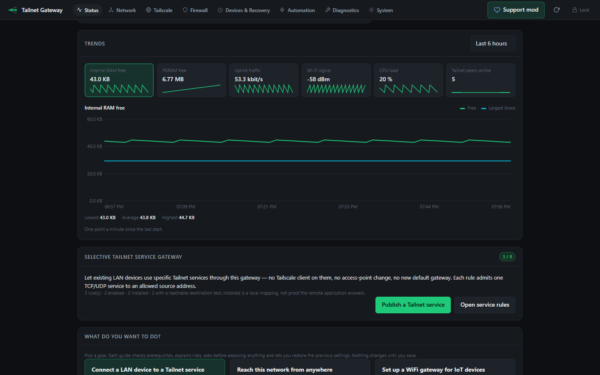
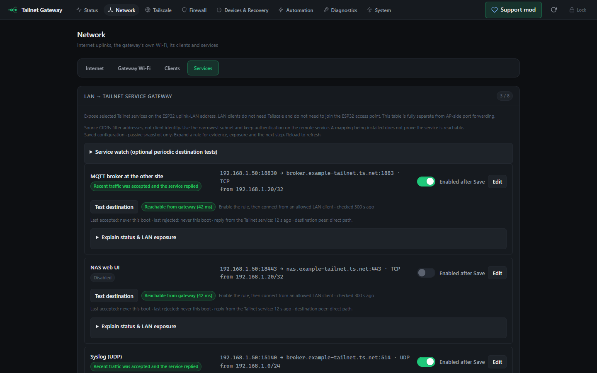
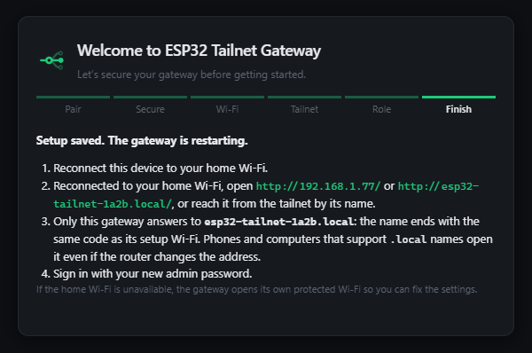
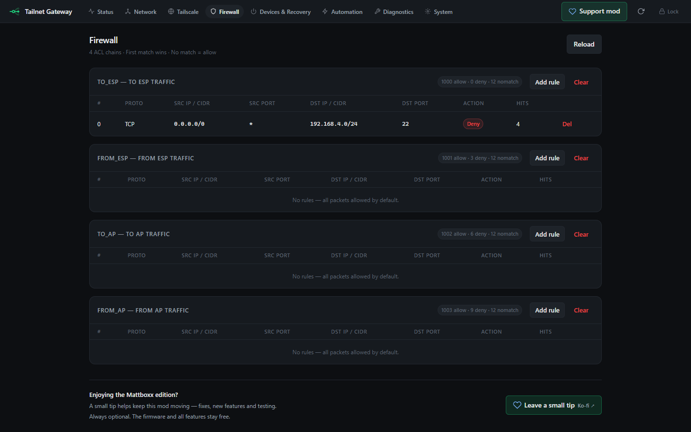
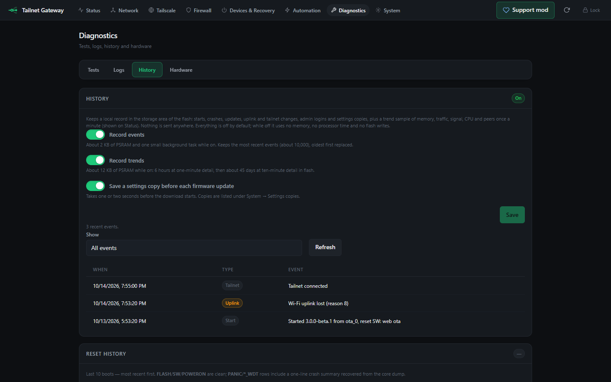
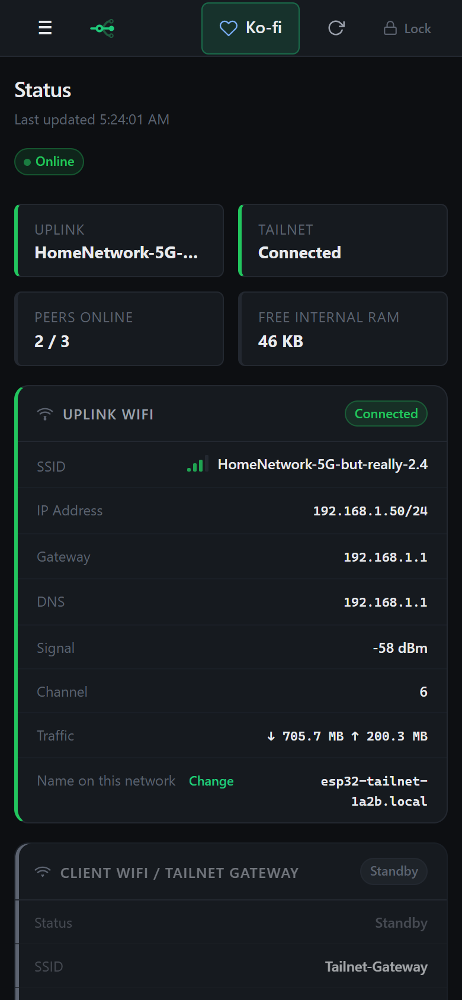

<div align="center">


# ESP32 Tailnet Gateway — Mattboxx Edition

**Mattboxx Edition · One ESP32. Multiple Tailnet roles. Enable only what you need.**

All-in-one ESP32-S3 Tailscale/Headscale gateway with selective LAN-to-Tailnet
access, subnet routing, remote recovery and optional automation.

**Runs on ESP32-S3 N8R8 and N16R8** (8 MB octal PSRAM, at least 8 MB flash) —
ESP32-S3-DevKitC-1, ESP32-S3-WROOM-1/1U, Freenove ESP32-S3-WROOM, Seeed XIAO
ESP32S3. [Supported boards](#8-supported-hardware)

> **Firmware v3.0.2 is available** for ESP32-S3 **N8R8** and **N16R8**.
> [Download the release](../../releases/tag/v3.0.2), use the
> [browser installer](https://mattboxx.github.io/esp32-tailnet-gateway/install-firmware/),
> or choose the Easy Install package below. **2.x gateways** move to 3.0
> keeping every setting: over the network with the **2.1.0 bridge** (a normal
> 2.x update), or once over USB without erasing —
> see [Moving to 3.0](docs/MIGRATION-3.0.md).

[](LICENSE)
[](#8-supported-hardware)
[](https://docs.espressif.com/projects/esp-idf/)
[](https://github.com/Mattboxx/esp32-tailnet-gateway/actions/workflows/codeql.yml)
[](../../releases/latest)
[](https://ko-fi.com/mattboxx)

[Website](https://mattboxx.github.io/esp32-tailnet-gateway/) ·
[Real firmware screenshots](https://mattboxx.github.io/esp32-tailnet-gateway/screenshots/) ·
[MQTT between two homes](https://mattboxx.github.io/esp32-tailnet-gateway/mqtt-across-networks/) ·
[Install firmware](https://mattboxx.github.io/esp32-tailnet-gateway/install-firmware/) ·
[Download](../../releases/latest) ·
[Getting started](docs/GETTING-STARTED.md) ·
[Service Gateway guide](docs/SERVICE-GATEWAY.md) ·
[Documentation](docs/README.md) ·
[Wiki](https://github.com/Mattboxx/esp32-tailnet-gateway/wiki)

</div>

> Community firmware built on Csontikka's
> [esp32-tailscale-subnet-router](https://github.com/Csontikka/esp32-tailscale-subnet-router)
> and the [microlink](https://github.com/Csontikka/microlink) stack. It is not an
> official Tailscale client and is not affiliated with Tailscale Inc.,
> the Headscale project or Espressif. Formerly *ESP32 Homelab Gateway*.

### New in Firmware 3.0.2

- **Reliable settings saves:** every settings page now saves all or nothing.
  If a write fails, or the power goes off in the middle, none of that change
  is kept, and live changes apply only after the whole save succeeded.
  Settings from 3.0.0/3.0.1 are kept, and going back to 3.0.1 keeps them too.

[Release notes](../../releases/tag/v3.0.2)

### New in Firmware 3.0.1

- **Dynamic DNS:** DuckDNS, Cloudflare or a custom HTTPS update URL. Optional;
  it updates a public name, not router ports or Tailnet access permissions.
- **Six languages:** English, Italiano, Español, 简体中文, Français and Deutsch,
  including the first-boot setup. Small cached language scripts load on demand.
- **Guided uplink setup:** choose Wi-Fi, W5500 Ethernet or a cellular modem,
  with browser time-zone detection. Ethernet/cellular remain experimental and
  require the appropriate hardware.
- **Clearer administration:** Firmware and Backup & reset sections, separate
  Telegram/email cards with their own Save, test and event selection, Status
  shortcuts and more complete role profiles.
- **Page fixes:** correct gzip headers, ETag caching and better mobile
  navigation/scroll positioning.

[Release notes](../../releases/tag/v3.0.1) ·
[Install from a computer](https://mattboxx.github.io/esp32-tailnet-gateway/install-firmware/) ·
[Set up from your phone](https://mattboxx.github.io/esp32-tailnet-gateway/first-boot/)

### The Firmware 3.0 platform

| Firmware 2.x | Firmware 3.0 |
|---|---|
| 4 MB layout, one Web UI language per image, separate Ethernet build | **One image** for N8R8 and N16R8 with every language (English, Italiano, Español, 简体中文) and the W5500 driver; 3.5 MB update slots |
| Long settings pages | **Reorganised Web UI:** each page shows one group at a time (Network, Tailscale, Diagnostics, Automation, System) |
| Logs lost at restart | **Event history** and **trends** with a chart on Status, kept in flash |
| Encrypted backup download | Plus up to three **settings copies** on the gateway, taken by hand or before each update |
| Tailnet names only on the gateway | **Tailnet names for local devices:** clients reach `nas` or `nas.<tailnet>.ts.net` without Tailscale |
| ntfy alerts | Plus **Telegram** and **email** notifications |
| — | **Throughput test**, experimental **cellular uplink**, a *Monitor and get alerts* setup role |
| About 17 KB of free internal RAM | About 44–47 KB, tables moved to PSRAM |

New optional services are **off until you switch them on**. Disabled services
do not run their background jobs; compiled code and static state still occupy
space. See the [changelog](CHANGELOG.md).

The advanced workflows described below require Firmware v2.0.0 or later unless listed in
the legacy 1.13 release. [Stable 1.13 instructions and source](https://github.com/Mattboxx/esp32-tailscale-gateway-NAS-recovery/tree/v0.1.38-Mattboxx-1.13)
remain available; [release notes](docs/releases/RELEASE-1.13.md) explain what is shipped.

### Is it for you?

| If you… | The gateway… |
|---|---|
| have a device that can't run Tailscale but must reach **one** service at another site | forwards one TCP/UDP port to that tailnet service, for one allowed source ([Service Gateway](docs/SERVICE-GATEWAY.md)) |
| want to know **what happened while you were away** | keeps an **event history** across restarts: power losses, crashes, Wi-Fi and tailnet drops, updates, failed logins *(3.0)* |
| want **trends**, not a snapshot | charts memory, traffic, Wi-Fi signal, CPU and peers: 6 h in detail, ~45 days in summary *(3.0)* |
| fear an update or a wrong click will cost your setup | keeps up to three **settings copies**, automatically before each update *(3.0)* |
| want local devices to reach `nas` **by name** | answers **tailnet names** for clients on its Wi-Fi or your LAN *(3.0)* |
| want **alerts** on your phone or inbox | sends **Telegram** and **email** (TLS/STARTTLS) next to ntfy, MQTT/Home Assistant and SNMP *(3.0)* |
| wonder whether the link is fast enough | runs a **throughput test** on request *(3.0)* |
| need to wake a NAS or PC remotely | sends Wake-on-LAN and checks that the service answers ([recovery](docs/NAS-RECOVERY.md)) |
| need a public name for your home connection | keeps a **dynamic DNS** name up to date: DuckDNS, Cloudflare or any update URL *([guide](docs/DDNS.md))* |
| have Ethernet or only a mobile SIM at the site | is set up for **Wi-Fi, an Ethernet cable or a SIM** right in the first-boot wizard |
| run a 2.x gateway | moves to 3.0 **keeping every setting** ([guide](docs/MIGRATION-3.0.md)) |

Every feature is a switch, off until you need it.

## 1. What it is

A small ESP32-S3 board that joins your Tailscale or Headscale tailnet once and
can then play several network roles. Every role is a switch: turn on the one
you need and leave the rest off.

## 2. The problem it solves

A device on your LAN — an IoT controller, a printer dashboard, a backup
client, an old PC — needs to reach **one** service on another site of your
tailnet: an MQTT broker, a NAS web UI, an SSH host. You cannot or do not want
to install Tailscale on it, move it to another WiFi network, replace the
router or advertise whole subnets to everyone.

Put an ESP32-S3 on the same LAN and publish one rule: *this LAN device may use
this Tailnet service on this port.*

## 3. How the Service Gateway works

<p align="center">

</p>

The LAN client talks to the ESP32's own LAN address and listen port. The
ESP32 admits the connection only when the rule is enabled and not expired, the
source is inside the rule's CIDR and protocol and port match, then carries it
over WireGuard to the Tailnet destination. The remote peer sees the ESP32's
tailnet identity, and its own ACLs still decide what it accepts.

## 4. A concrete example

Addresses below use documentation-only ranges. Substitute your own LAN and
Tailnet addresses; they are not a real deployment configuration.

Your home-automation controller at `192.0.2.20` must publish to an MQTT
broker at your other site, `broker.your-tailnet.ts.net:1883`. The ESP32 has a
fixed LAN address, `192.0.2.50`.

| Field | Value |
|---|---|
| Protocol | TCP |
| Listen port on the ESP32 | `18830` |
| Tailnet destination | `broker.your-tailnet.ts.net` (or `100.x.y.z`) |
| Destination port | `1883` |
| Allowed source | `192.0.2.20/32` |
| Expiry (optional) | e.g. 24 h for temporary access |

In **Firmware v2**, run **Test destination** (one bounded TCP handshake from the ESP32), enable the
rule and point the controller at `192.0.2.50:18830`. The rule card shows the
installed state, accepted/rejected counters and the last evidence seen.
Any other LAN device that tries the port is refused.

## 5. One firmware, multiple roles

| Role | Direction | Default | Guide |
|---|---|---|---|
| **Selective Service Gateway** | LAN → one Tailnet service | rules start disabled | [Service Gateway](docs/SERVICE-GATEWAY.md) |
| Subnet router | Tailnet → LAN / AP subnets | off | [Subnet router](docs/SUBNET-ROUTER.md) |
| AP gateway for IoT | AP devices → Internet / Tailnet | recovery-only AP | [Network modes](docs/CONFIGURATION.md) |
| Exit node (client or server) | Internet via a peer, or for peers | off | [Exit node](docs/EXIT-NODE.md) |
| Remote recovery | Wake-on-LAN + bounded checks | off | [NAS recovery](docs/NAS-RECOVERY.md) |
| Automation | MQTT, Home Assistant, ntfy, SNMP | off | [Guides](docs/GUIDES.md) |

Configuration profiles (Gateway, Recovery, IoT, Monitoring, Advanced) preview
their changes and can be rolled back.

## 6. Quick start

These steps apply to Firmware 3.0 (and 2.x). For legacy installations use
the [versioned 1.13 instructions](https://github.com/Mattboxx/esp32-tailscale-gateway-NAS-recovery/tree/v0.1.38-Mattboxx-1.13).

1. **Install** by desktop browser, Easy Install or advanced download below.
   Use a USB **data** cable. Erase only for a new setup, never for a routine update.
2. **Join** `ESP32-Tailnet-Setup-XXXX` on a genuinely unconfigured gateway.
   A captive page should open; otherwise browse to `http://192.168.4.1/`.
3. **Pair physically:** press the board's **BOOT** button, or enter its current
   8-digit USB-console setup code. There is no shared default admin password.
4. **Follow the wizard:** choose an admin password, test your 2.4 GHz WiFi,
   optionally enrol in Tailscale or Headscale, and select only the roles needed.
   Choose a protected gateway/recovery WiFi name and password, then restart.
5. **Open** the gateway from your home WiFi with a link shown on the last
   setup page: the address its WiFi test received, or
   `http://esp32-tailnet-xxxx.local/`, where `xxxx` is the code of its setup
   WiFi by default. Use the actual name shown by setup if a hostname was
   configured. Opening a `.local` name requires mDNS support on the client
   and LAN; use the tested IP address if name resolution is unavailable.
6. **Reserve** a LAN address on your router. Add a rule under **Network →
   LAN → Tailnet**, review its allowed source and run **Test destination**.

An existing installation keeps its settings and does **not** reopen the setup
network. First setup is English-only; the main administration UI retains its
existing translations. The setup network forwards no LAN/Internet traffic;
credentials use sealed setup requests. Set up nearby on a trusted physical site:
a malicious lookalike access point remains a risk.

Full walk-through: [First boot](https://mattboxx.github.io/esp32-tailnet-gateway/first-boot/).

## 7. Download firmware

### Three installation methods

| Method | Best for | How |
|---|---|---|
| **Browser installer** | New WiFi gateway, no flashing application | [Install Firmware](https://mattboxx.github.io/esp32-tailnet-gateway/install-firmware/) in desktop Chrome/Edge over USB |
| **Easy Install** | Guided Windows, macOS or Linux setup | One ZIP, separate new-device and keep-settings scripts; [guide](https://mattboxx.github.io/esp32-tailnet-gateway/easy-install/) |
| **Advanced downloads** | Web UI OTA, manual flashing or experimental W5500 | [Downloads](https://mattboxx.github.io/esp32-tailnet-gateway/downloads/) with exact checksums, variant labels and recovery notes |

Firmware v3.0.2 release assets:

| Asset | Use |
|---|---|
| `ESP32-Tailnet-Gateway-v3.0.2-EASY-INSTALL-Windows-macOS-Linux.zip` | Guided USB install (new device) or update keeping settings |
| `firmware.bin` | Application image for the Web UI updater on 3.x |
| `bootloader.bin`, `partitions.bin` | 3.0 boot loader and partition table (manual USB update keeping settings) |
| `ESP32-Tailnet-Gateway-v3.0.2-factory.bin` | Full image for a new device at offset `0x0` (erases settings) |
| `SHA256SUMS.txt`, `release-manifest.json`, `source-provenance.json`, `FIRMWARE-LICENSES.txt` | Checksums, build metadata, exact source revision and third-party notices |

The **2.1.0 bridge** release carries only a 2.x `firmware.bin` for the
network migration. The [legacy 1.13 release](https://github.com/Mattboxx/esp32-tailscale-gateway-NAS-recovery/releases/tag/v0.1.38-Mattboxx-1.13)
keeps its original files.

## 8. Supported hardware

<p align="center">

</p>

Firmware 3.x runs on **ESP32-S3 with 8 MB octal PSRAM and at least 8 MB of
quad flash**:

| Supported | Not supported |
|---|---|
| **N16R8** — e.g. ESP32-S3-DevKitC-1 N16R8, WROOM-1/1U-N16R8 (**tested**) | 4 MB flash (N4…): stay on 2.x |
| **N8R8** — e.g. ESP32-S3-DevKitC-1 N8R8, WROOM-1/1U-N8R8, Freenove N8R8, Seeed XIAO ESP32S3 (same layout, not yet tested on 3.x) | R2 or no PSRAM, octal-flash modules (WROOM-2, N16R16V, N32R8V), other ESP32 chips |

Details and community reports: [Hardware](docs/HARDWARE.md).

## 9. Screenshots

Firmware v3.0.0 Web UI, rendered from the page embedded in the firmware with
invented documentation data (no real network, device or credential).
[Captures from a real gateway](https://mattboxx.github.io/esp32-tailnet-gateway/screenshots/)
are on the website.

<p align="center">

<br><em>Status: live summary first</em>
</p>

<p align="center">

<br><em>Trends: pick a measure for a chart with time and value axes</em>
</p>

<p align="center">

<br><em>Network → Services: one group of cards at a time</em>
</p>

<p align="center">

<br><em>End of first-boot setup: where to open the gateway after the restart</em>
</p>

<p align="center">

<br><em>Firewall: four ACL chains with per-chain counters</em>
</p>

<p align="center">


<br><em>Event history, and the Status page on a phone</em>
</p>

## 10. Features

- **Service Gateway:** up to 8 TCP/UDP rules, mandatory source CIDR, per-rule
  binding token, optional expiry, templates, guided setup, destination test,
  Service watch, counters and sanitized import/export.
- **Tailscale and Headscale:** DISCO, direct paths with DERP fallback,
  MagicDNS names, Tailnet policy gate, subnet routes, 4via6, exit node client
  and server.
- **Gateway:** WiFi STA + AP with DHCP, cached DNS forwarder, NAT, AP-side
  port forwarding, four firewall chains with hit counters.
- **Recovery:** Wake-on-LAN address book, bounded Smart Recovery jobs, recovery
  access point that returns 60 s after the saved WiFi disappears.
- **Diagnostics:** evidence per layer, route explain, ping, traceroute, WiFi
  scan, logs, optional microSD recorder, diagnostic export.
- **History (3.0):** event history, trends with a chart, settings copies
  before updates, kept in the flash storage area.
- **Automation:** MQTT with Home Assistant Discovery, ntfy alerts and commands,
  Telegram and email notifications ([guide](docs/NOTIFICATIONS.md)), read-only
  SNMP — all optional and supervised.
- **Languages:** English, Italiano, Español, 简体中文; Français and Deutsch and
  the translated first-boot setup from 3.0.1 ([details](docs/I18N.md)).
- **Tailnet names (3.0):** gateway Wi-Fi and LAN clients resolve tailnet
  peers by name.
- **Management:** responsive Web UI and API, profiles with rollback, encrypted
  backup/restore, opt-in OTA updates with application rollback.
- **Privacy:** no telemetry, no crash or log uploads, no forced update polling.

## 11. Security

- PBKDF2-HMAC-SHA256 password verifier with a one-time login challenge,
  device-wide login budget, `SameSite=Strict` session cookie.
- State-changing requests are screened against cross-origin and cross-site
  use; untrusted `Host` names are refused when no password is set (DNS
  rebinding).
- First boot is restricted to the setup AP, requires physical pairing and
  seals setup requests with X25519/AES-256-GCM. It does not authenticate the
  downloaded page against an active nearby impersonator; use a trusted setup site.
- Tailnet authorization is checked on original packets before NAT, fails
  closed on malformed or revoked policy and is not a claim of full
  official-client policy parity.
- A Service Gateway source filter is **not** client identity: prefer `/32`.
- The local Web UI is HTTP; administer it from a trusted LAN/AP or over the
  tailnet. The portable image does not enable Secure Boot or flash encryption.

Report vulnerabilities privately: see [SECURITY.md](SECURITY.md).

## 12. Diagnostics

<p align="center">

</p>

An installed mapping is not a verified service, and a control connection is
not a working data plane. Each layer is reported separately; missing
observations stay *unknown*. See [Troubleshooting](docs/TROUBLESHOOTING.md)
and [Network health](docs/NETWORK-HEALTH.md).

## 13. Remote Recovery

<p align="center">

</p>

Because the ESP32 is its own tailnet node, you can reach it while your NAS and
its Tailscale client are off. Wake-on-LAN needs compatible hardware and
standby power; it cannot hard-reset a frozen machine and is not KVM or BIOS
access. See [Smart Recovery](docs/SMART-RECOVERY.md) and the
[NAS recovery checklist](docs/NAS-RECOVERY.md).

## 14. Automation

<p align="center">

</p>

[MQTT](docs/MQTT.md) · [Home Assistant](docs/HOME-ASSISTANT.md) ·
[ntfy](docs/NTFY.md). Each integration is off by default, supervised and
unable to block routing or local administration.

## 15. Compared with alternatives and upstream

| Approach | What LAN devices need | What it exposes | Best for |
|---|---|---|---|
| **Service Gateway** (this firmware) | Nothing: connect to `ESP-IP:port` | One TCP/UDP service per rule, to one source CIDR | A few devices that must reach specific remote services |
| Tailscale on each device | A Tailscale client | That device as a full node | Devices that can run a client |
| Subnet router (also here) | Nothing; reverse direction | Whole subnets *to* the tailnet, after approval | Reaching your LAN from tailnet clients |
| Raspberry Pi gateway | A Linux box to maintain | Whatever you configure | Higher throughput, more services |
| Router replacement | New default gateway | Whole site | Site-wide routing |

**Upstream:** Csontikka's firmware provides the Tailscale stack, AP router,
subnet routing, firewall and Web UI foundation. This edition adds the
Service Gateway, recovery and diagnostics, automation, security hardening and
packaging. Every change is listed in the [release history](CHANGELOG.md);
the [documentation index](docs/README.md) covers each feature.

## 16. Limitations

- **Throughput:** a microcontroller doing userspace WireGuard on one shared
  2.4 GHz radio. Upstream measurements were roughly 0.3–1.4 Mbit/s through the
  tunnel; the 3.0 throughput test measured 0.2–2.6 Mbit/s for internet
  downloads on an N16R8, varying with the radio and the path. Use it for control,
  telemetry, dashboards and SSH, not video or bulk transfers.
- **Service Gateway scope:** IPv4 TCP/UDP, up to 8 rules, one Tailnet IPv4
  destination per rule; a port forwarder, not transparent routing. UDP cannot
  be verified without an application reply.
- **Exit node:** IPv4 only; IPv6 fails closed. A selected exit node fails
  closed when unreachable.
- **Not supported:** tailnet lock; Headscale with self-signed certificates.
- **Experimental hardware:** W5500 requires compatible hardware and pin settings.
  This embedded community client does not promise full official-client policy parity.
  See [release availability](docs/PRESENTATION-STATUS.md).

## 17. Documentation

[Documentation index](docs/README.md) ·
[Getting started](docs/GETTING-STARTED.md) ·
[All guides](docs/GUIDES.md) ·
[Configuration reference](docs/CONFIGURATION.md) ·
[Architecture](docs/ARCHITECTURE.md) ·
[Tailnet authorization](docs/TAILNET-AUTHORIZATION.md) ·
[Backup and restore](docs/BACKUP-RESTORE.md) ·
[Headscale](docs/HEADSCALE.md) ·
[Updates](docs/UPDATES.md) ·
[Testing](docs/TESTING.md) ·
[Release availability](docs/PRESENTATION-STATUS.md)

<p align="center">

</p>

## 18. Installation and OTA updates

For **Firmware v3.0.2**, the browser route is the easiest first install. Safari,
Firefox and phone browsers should use a desktop computer and Easy Install.

**Easy Install:** unzip
`ESP32-Tailnet-Gateway-v3.0.2-EASY-INSTALL-Windows-macOS-Linux.zip` and read
`START-HERE.txt`. Windows includes esptool; macOS/Linux need Python 3 and
esptool 5. The scripts verify checksums and the ESP32-S3 target first.

| System | New device — explicit erase confirmation | Keep settings |
|---|---|---|
| Windows | `windows\INSTALL-NEW-DEVICE.bat` | `windows\UPDATE-KEEP-SETTINGS.bat` |
| macOS / Linux | `sh macos-linux/install.sh new` | `sh macos-linux/install.sh update` |

**From 2.x:** follow [Moving to 3.0](docs/MIGRATION-3.0.md) — the 2.1.0
bridge over the network, or `UPDATE-KEEP-SETTINGS` / `install.sh update`
over USB. Settings are kept either way.

**Updates:** upload `firmware.bin` in System → Firmware, or enable the opt-in
GitHub updater (stable or beta channel). This inactive-slot Web UI method is
preferred over USB because it preserves the previous app as a fallback. USB
keep-settings installation preserves NVS but writes the first app slot and
initial OTA selection; it is **not** an inactive-slot OTA operation. Do not
use it to overwrite a deliberately protected recovery image.
Back up your configuration first; see [Updates](docs/UPDATES.md) and
[Backup and restore](docs/BACKUP-RESTORE.md).

**Legacy OTA migration:** the bridge `0.1.38-Mattboxx-1.100` was published under
the previous repository name before the rename. Older updaters cannot follow
the renamed API. Devices still on 1.13 or earlier need one manual Web UI/USB
update if they missed the bridge; settings can be kept.

**Build from source:**

```bash
git clone --recurse-submodules https://github.com/Mattboxx/esp32-tailnet-gateway
cd esp32-tailnet-gateway
pio run -e esp32-s3            # 3.x image (every language, Ethernet driver)
pio run -e esp32-s3-bridge     # 2.1 migration bridge (build esp32-s3 first)
```

## 19. Contributing

Bug reports, hardware reports and guide improvements are welcome. Read
[CONTRIBUTING.md](CONTRIBUTING.md) and the [code of conduct](CODE_OF_CONDUCT.md);
use the issue templates. Follow the checks in [Testing](docs/TESTING.md) for
the published source.

Support the Mattboxx edition on Ko-fi — entirely optional:

[](https://ko-fi.com/mattboxx)

Support the original author via
[GitHub Sponsors](https://github.com/sponsors/Csontikka) or
[Buy Me a Coffee](https://buymeacoffee.com/csontikka) — entirely optional.

## 20. Credits and licences

MIT licensed ([LICENSE](LICENSE)). Built on:

- **[Csontikka/esp32-tailscale-subnet-router](https://github.com/Csontikka/esp32-tailscale-subnet-router)** —
  the original firmware this edition forks.
- **[microlink](https://github.com/Csontikka/microlink)** — Tailscale `ts2021`
  client (MIT), based on [CamM2325/microlink](https://github.com/CamM2325/microlink).
- **wireguard_lwip** — userspace WireGuard for lwIP (BSD-3-Clause).
- **[ESP-IDF](https://github.com/espressif/esp-idf)** — Espressif SDK (Apache-2.0).

Full attribution: [NOTICE.md](NOTICE.md). Brand assets: [assets/brand](assets/brand/BRAND.md).
Tailscale, Headscale, WireGuard and ESP32 are trademarks of their respective
owners. Previous stable README: [1.13 documentation](https://github.com/Mattboxx/esp32-tailscale-gateway-NAS-recovery/blob/v0.1.38-Mattboxx-1.13/README.md).
