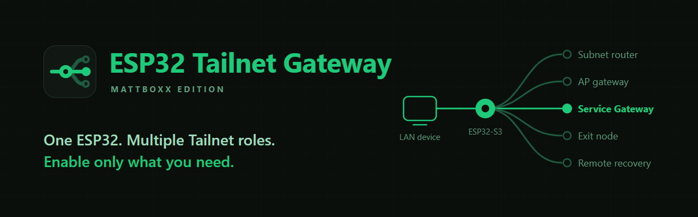
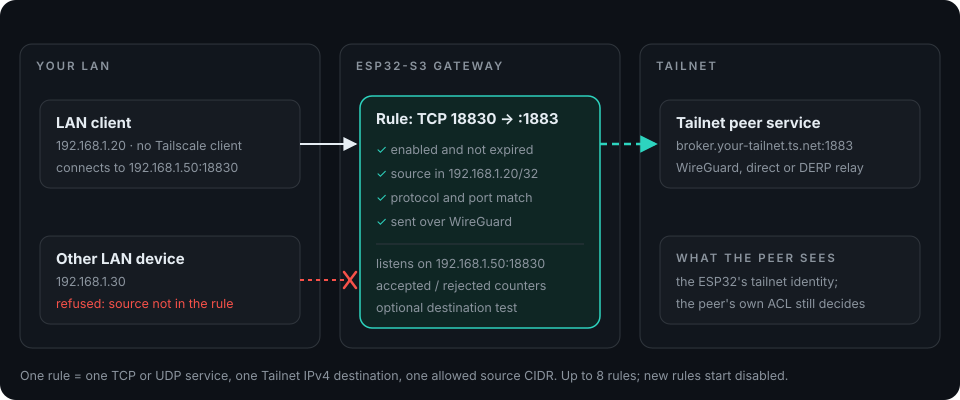
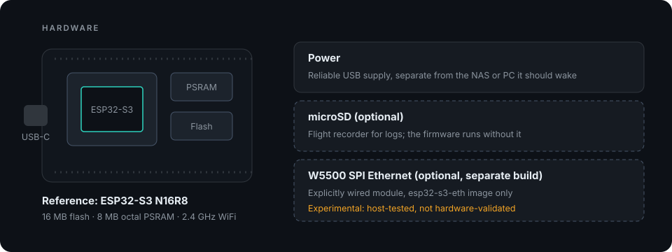
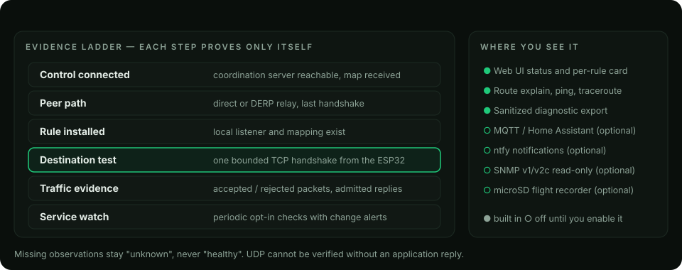
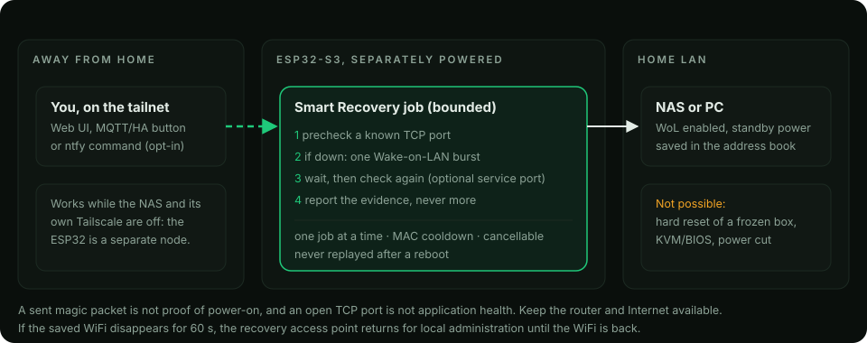
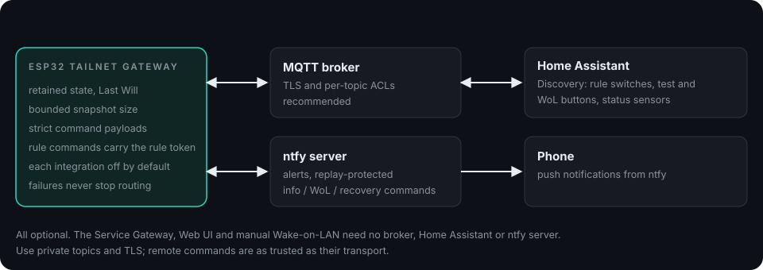
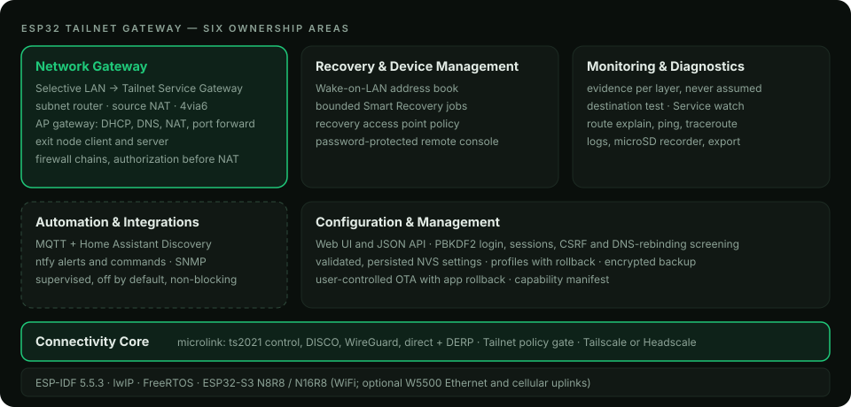

<div align="center">



# ESP32 Tailnet Gateway

**Mattboxx Edition · One ESP32. Multiple Tailnet roles. Enable only what you need.**

All-in-one ESP32-S3 Tailscale/Headscale gateway with selective LAN-to-Tailnet
access, subnet routing, remote recovery and optional automation.

> **New identity; the next generation is in development.** The current public
> stable download remains **[0.1.38-Mattboxx-1.13](https://github.com/Mattboxx/esp32-tailscale-gateway-NAS-recovery/releases/tag/v0.1.38-Mattboxx-1.13)**.
> This presentation also previews **1.14**, which is not yet a stable release.
> No new firmware is published by this branding update.

[](LICENSE)
[](#8-supported-hardware)
[](https://docs.espressif.com/projects/esp-idf/)
[](https://github.com/Mattboxx/esp32-tailscale-gateway-NAS-recovery/actions/workflows/codeql.yml)
[](../../releases/latest)

[Website](https://mattboxx.github.io/esp32-tailscale-gateway-NAS-recovery/) ·
[Download](../../releases/latest) ·
[Getting started](docs/GETTING-STARTED.md) ·
[Service Gateway guide](docs/SERVICE-GATEWAY.md) ·
[All guides](docs/GUIDES.md)

</div>

> Community firmware built on Csontikka's
> [esp32-tailscale-subnet-router](https://github.com/Csontikka/esp32-tailscale-subnet-router)
> and the [microlink](https://github.com/Csontikka/microlink) stack. It is not an
> official Tailscale client and is not affiliated with Tailscale Inc.,
> the Headscale project or Espressif. Formerly *ESP32 Homelab Gateway*.

### What can I download today?

| Public stable 1.13 | Next-generation 1.14 — in development |
|---|---|
| LAN → Tailnet TCP/UDP forwarding with source restrictions and MagicDNS | Destination tests, timed access, Service Watch and guided rule setup |
| Subnet routing, AP gateway, exit-node roles and 4via6 | Refreshed goal-oriented UI, Simple/Advanced modes and profiles |
| Saved Wake-on-LAN devices; MQTT/Home Assistant, ntfy and read-only SNMP | Smart Recovery workflows, layered Health Monitor and diagnostic export |
| WiFi build for ESP32-S3 N16R8 | Optional W5500 build: experimental, not hardware-qualified |

The advanced workflows described below preview 1.14 unless listed in the
stable column. [Stable 1.13 instructions and source](https://github.com/Mattboxx/esp32-tailscale-gateway-NAS-recovery/tree/v0.1.38-Mattboxx-1.13)
remain available; [release notes](docs/RELEASE-1.13.md) explain what is shipped.

## 1. What it is

A small ESP32-S3 board that joins your Tailscale or Headscale tailnet once and
can then play several network roles. Every role is a switch: turn on the one
you need and leave the rest off.

## 2. The problem it solves

A device on your LAN — an IoT controller, a printer dashboard, a backup
client, an old PC — needs to reach **one** service on another site of your
tailnet: an MQTT broker, a NAS web UI, an SSH host. You cannot or do not want
to install Tailscale on it, move it to another WiFi network, replace the
router or advertise whole subnets to everyone.

Put an ESP32-S3 on the same LAN and publish one rule: *this LAN device may use
this Tailnet service on this port.*

## 3. How the Service Gateway works

<p align="center">

</p>

The LAN client talks to the ESP32's own LAN address and listen port. The
ESP32 admits the connection only when the rule is enabled and not expired, the
source is inside the rule's CIDR and protocol and port match, then carries it
over WireGuard to the Tailnet destination. The remote peer sees the ESP32's
tailnet identity, and its own ACLs still decide what it accepts.

## 4. A concrete example

Addresses below use documentation-only ranges. Substitute your own LAN and
Tailnet addresses; they are not a real deployment configuration.

Your home-automation controller at `192.0.2.20` must publish to an MQTT
broker at your other site, `broker.your-tailnet.ts.net:1883`. The ESP32 has a
fixed LAN address, `192.0.2.50`.

| Field | Value |
|---|---|
| Protocol | TCP |
| Listen port on the ESP32 | `18830` |
| Tailnet destination | `broker.your-tailnet.ts.net` (or `100.x.y.z`) |
| Destination port | `1883` |
| Allowed source | `192.0.2.20/32` |
| Expiry (optional) | e.g. 24 h for temporary access |

In the **1.14 preview**, run **Test destination** (one bounded TCP handshake from the ESP32), enable the
rule and point the controller at `192.0.2.50:18830`. The rule card shows the
installed state, accepted/rejected counters and the last evidence seen.
Any other LAN device that tries the port is refused.

## 5. One firmware, multiple roles

| Role | Direction | Default | Guide |
|---|---|---|---|
| **Selective Service Gateway** | LAN → one Tailnet service | rules start disabled | [Service Gateway](docs/SERVICE-GATEWAY.md) |
| Subnet router | Tailnet → LAN / AP subnets | off | [Subnet router](docs/SUBNET-ROUTER.md) |
| AP gateway for IoT | AP devices → Internet / Tailnet | recovery-only AP | [Network modes](docs/CONFIGURATION.md) |
| Exit node (client or server) | Internet via a peer, or for peers | off | [Exit node](docs/EXIT-NODE.md) |
| Remote recovery | Wake-on-LAN + bounded checks | off | [NAS recovery](docs/NAS-RECOVERY.md) |
| Automation | MQTT, Home Assistant, ntfy, SNMP | off | [Guides](docs/GUIDES.md) |

Configuration profiles (Gateway, Recovery, IoT, Monitoring, Advanced) preview
their changes and can be rolled back.

## 6. Quick start

1. **Flash** the latest release with the guided Windows ZIP, or any esptool
   front-end (see [Installation and OTA](#18-installation-and-ota-updates)).
2. **Join** the setup access point printed on the serial console (default
   `ESP32-TSR-Setup`), open `http://192.168.4.1`, set an admin password and
   your 2.4 GHz WiFi.
3. **Enrol** on your tailnet: paste a reusable, non-ephemeral auth key (or a
   Headscale pre-auth key plus login server), then disable node-key expiry in
   the admin console.
4. **Reserve** a fixed LAN address for the ESP32 on your router.
5. **Add a Service Gateway rule** (Network → LAN → Tailnet), review its source
   restriction and enable it. Destination tests are a **1.14 preview** feature.

Full walk-through with screenshots: [Getting started](docs/GETTING-STARTED.md).

## 7. Download firmware

The current [stable 1.13 release](https://github.com/Mattboxx/esp32-tailscale-gateway-NAS-recovery/releases/tag/v0.1.38-Mattboxx-1.13) contains:

| Asset | Use |
|---|---|
| `firmware-factory.bin` | Full image for a first install at offset `0x0` (erases settings) |
| `firmware.bin` | Application image for the Web UI updater or keep-settings updates |
| `ESP32-S3-router-0.1.38-Mattboxx-1.13-windows.zip` | Guided Windows package with esptool and batch files |
| `RELEASE-SHA256SUMS.txt`, `FIRMWARE-LICENSES.txt` | Published checksums and third-party notices; no 1.14 manifest or firmware is published yet |

The WiFi build is the default. An **Ethernet (W5500) variant**, when
published, is labelled separately and is only for boards with that module
wired as documented in [Ethernet](docs/ETHERNET.md). Never flash it by mistake.

## 8. Supported hardware

<p align="center">

</p>

The published images target **ESP32-S3 with 16 MB flash and 8 MB octal PSRAM
(N16R8)**, e.g. ESP32-S3-DevKitC-1 N16R8. Community reports for other boards
are listed in [Hardware](docs/HARDWARE.md). Other ESP32 families are not
drop-in targets.

## 9. Screenshots

Authentic captures from earlier stable versions; current development screens
are captured during release qualification.

<p align="center">

<br><em>Status dashboard (stable 1.x)</em>
</p>

<p align="center">

<br><em>Firewall chains (stable 1.x)</em>
</p>

## 10. Features

- **Service Gateway:** up to 8 TCP/UDP rules, mandatory source CIDR, per-rule
  binding token, optional expiry, templates, guided setup, destination test,
  Service watch, counters and sanitized import/export.
- **Tailscale and Headscale:** DISCO, direct paths with DERP fallback,
  MagicDNS names, Tailnet policy gate, subnet routes, 4via6, exit node client
  and server.
- **Gateway:** WiFi STA + AP with DHCP, cached DNS forwarder, NAT, AP-side
  port forwarding, four firewall chains with hit counters.
- **Recovery:** Wake-on-LAN address book, bounded Smart Recovery jobs, recovery
  access point that returns 60 s after the saved WiFi disappears.
- **Diagnostics:** evidence per layer, route explain, ping, traceroute, WiFi
  scan, logs, optional microSD recorder, diagnostic export.
- **Automation:** MQTT with Home Assistant Discovery, ntfy alerts and commands,
  read-only SNMP — all optional and supervised.
- **Management:** responsive Web UI and API, profiles with rollback, encrypted
  backup/restore, opt-in OTA updates with application rollback.
- **Privacy:** no telemetry, no crash or log uploads, no forced update polling.

## 11. Security

- PBKDF2-HMAC-SHA256 password verifier with a one-time login challenge,
  device-wide login budget, `SameSite=Strict` session cookie.
- State-changing requests are screened against cross-origin and cross-site
  use; untrusted `Host` names are refused when no password is set (DNS
  rebinding).
- Tailnet authorization is checked on original packets before NAT, fails
  closed on malformed or revoked policy and is not a claim of full
  official-client policy parity.
- A Service Gateway source filter is **not** client identity: prefer `/32`.
- The local Web UI is HTTP; administer it from a trusted LAN/AP or over the
  tailnet. The portable image does not enable Secure Boot or flash encryption.

Report vulnerabilities privately: see [SECURITY.md](SECURITY.md).

## 12. Diagnostics

<p align="center">

</p>

An installed mapping is not a verified service, and a control connection is
not a working data plane. Each layer is reported separately; missing
observations stay *unknown*. See [Troubleshooting](docs/TROUBLESHOOTING.md)
and [Network health](docs/NETWORK-HEALTH.md).

## 13. Remote Recovery

<p align="center">

</p>

Because the ESP32 is its own tailnet node, you can reach it while your NAS and
its Tailscale client are off. Wake-on-LAN needs compatible hardware and
standby power; it cannot hard-reset a frozen machine and is not KVM or BIOS
access. See [Smart Recovery](docs/SMART-RECOVERY.md) and the
[NAS recovery checklist](docs/NAS-RECOVERY.md).

## 14. Automation

<p align="center">

</p>

[MQTT](docs/MQTT.md) · [Home Assistant](docs/HOME-ASSISTANT.md) ·
[ntfy](docs/NTFY.md). Each integration is off by default, supervised and
unable to block routing or local administration.

## 15. Compared with alternatives and upstream

| Approach | What LAN devices need | What it exposes | Best for |
|---|---|---|---|
| **Service Gateway** (this firmware) | Nothing: connect to `ESP-IP:port` | One TCP/UDP service per rule, to one source CIDR | A few devices that must reach specific remote services |
| Tailscale on each device | A Tailscale client | That device as a full node | Devices that can run a client |
| Subnet router (also here) | Nothing; reverse direction | Whole subnets *to* the tailnet, after approval | Reaching your LAN from tailnet clients |
| Raspberry Pi gateway | A Linux box to maintain | Whatever you configure | Higher throughput, more services |
| Router replacement | New default gateway | Whole site | Site-wide routing |

**Upstream:** Csontikka's firmware provides the Tailscale stack, AP router,
subnet routing, firewall and Web UI foundation. This edition adds the
Service Gateway, recovery and diagnostics, automation, security hardening and
packaging. The full list is in [CUSTOM_BRANCH.md](CUSTOM_BRANCH.md) and the
[release history](CHANGELOG.md).

## 16. Limitations

- **Throughput:** a microcontroller doing userspace WireGuard on one shared
  2.4 GHz radio. Upstream measurements were roughly 0.3–1.4 Mbit/s through the
  tunnel; the current candidate has not been benchmarked. Use it for control,
  telemetry, dashboards and SSH, not video or bulk transfers.
- **Service Gateway scope:** IPv4 TCP/UDP, up to 8 rules, one Tailnet IPv4
  destination per rule; a port forwarder, not transparent routing. UDP cannot
  be verified without an application reply.
- **Exit node:** IPv4 only; IPv6 fails closed. A selected exit node fails
  closed when unreachable.
- **Not supported:** tailnet lock; Headscale with self-signed certificates.
- **Development qualification still open:** the W5500 Ethernet build and full
  two-client policy compatibility. See [release availability](docs/PRESENTATION-STATUS.md).

## 17. Documentation

[Getting started](docs/GETTING-STARTED.md) ·
[All guides](docs/GUIDES.md) ·
[Configuration reference](docs/CONFIGURATION.md) ·
[Architecture](docs/ARCHITECTURE.md) ·
[Tailnet authorization](docs/TAILNET-AUTHORIZATION.md) ·
[Backup and restore](docs/BACKUP-RESTORE.md) ·
[Headscale](docs/HEADSCALE.md) ·
[Updates](docs/UPDATES.md) ·
[Testing](docs/TESTING.md) ·
[Development preview](docs/PRESENTATION-STATUS.md)

<p align="center">

</p>

## 18. Installation and OTA updates

**Windows:** unzip the release package, connect the board over USB and run
`UPDATE_KEEP_SETTINGS.bat` (keeps configuration) or
`CLEAN_INSTALL_ERASE_ALL.bat` (fresh install).

**Linux/macOS:** install `esptool` and flash the factory image for a first
install:

```bash
esptool.py --chip esp32s3 --baud 921600 write_flash 0x0 firmware-factory.bin
```

**Updates:** upload `firmware.bin` in System → Firmware, or enable the opt-in
GitHub updater (stable or beta channel). The new image must confirm a healthy
boot or the bootloader returns to the previous one. Settings are kept.
Back up your configuration first; see [Updates](docs/UPDATES.md) and
[Backup and restore](docs/BACKUP-RESTORE.md).

**Build from source:**

```bash
git clone --recurse-submodules https://github.com/Mattboxx/esp32-tailscale-gateway-NAS-recovery
cd esp32-tailnet-gateway
pio run -e esp32-s3            # WiFi build
pio run -e esp32-s3-eth        # optional W5500 Ethernet build
```

## 19. Contributing

Bug reports, hardware reports and guide improvements are welcome. Read
[CONTRIBUTING.md](CONTRIBUTING.md) and the [code of conduct](CODE_OF_CONDUCT.md);
use the issue templates. Follow the checks in [Testing](docs/TESTING.md) for
the published source; the expanded development suite is not shipped yet.
Support the Mattboxx edition on
[Ko-fi](https://ko-fi.com/mattboxx) and the original author via
[GitHub Sponsors](https://github.com/sponsors/Csontikka) or
[Buy Me a Coffee](https://buymeacoffee.com/csontikka) — entirely optional.

## 20. Credits and licences

MIT licensed ([LICENSE](LICENSE)). Built on:

- **[Csontikka/esp32-tailscale-subnet-router](https://github.com/Csontikka/esp32-tailscale-subnet-router)** —
  the original firmware this edition forks.
- **[microlink](https://github.com/Csontikka/microlink)** — Tailscale `ts2021`
  client (MIT), based on [CamM2325/microlink](https://github.com/CamM2325/microlink).
- **wireguard_lwip** — userspace WireGuard for lwIP (BSD-3-Clause).
- **[ESP-IDF](https://github.com/espressif/esp-idf)** — Espressif SDK (Apache-2.0).

Full attribution: [NOTICE.md](NOTICE.md). Brand assets: [assets/brand](assets/brand/BRAND.md).
Tailscale, Headscale, WireGuard and ESP32 are trademarks of their respective
owners. Previous stable README: [1.13 documentation](https://github.com/Mattboxx/esp32-tailscale-gateway-NAS-recovery/blob/v0.1.38-Mattboxx-1.13/README.md).
